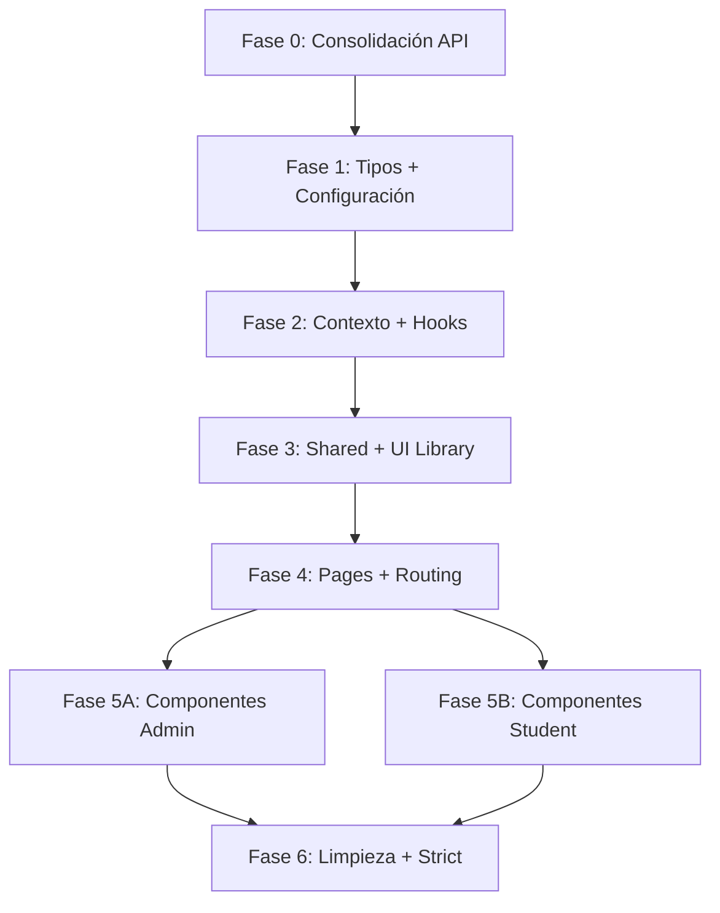

# Plan de Migración Frontend — JS → TypeScript + Consolidación API

> **Fecha:** 11 de octubre de 2026  
> **Alcance:** Migración completa del frontend a TypeScript + consolidación de la capa API  
> **Estado actual:** 18/66 archivos en TS (27%) — solo `src/api/` parcial y `src/types/index.ts`

---

## PARTE 1 — Auditoría de Endpoints Backend vs. Frontend

### 1.1 Inventario real de archivos en `src/api/`

| Archivo | Estado | Observación |
|---------|--------|-------------|
| `httpClient.ts` | ✅ Migrado | Axios instance con interceptors tipados |
| `httpClient.js` | ⚠️ Duplicado | Versión JS sin tipos — debe eliminarse |
| `client.js` | ⚠️ Legacy | Otra instancia Axios sin interceptors — debe eliminarse |
| `admin.api.ts` | ✅ Migrado | 5 funciones |
| `graph.api.ts` | ✅ Migrado | 6 funciones |
| `route.api.ts` | ✅ Migrado | 3 funciones (incompleto) |
| `resource.api.ts` | ✅ Migrado | 4 funciones (incluye uploadFile) |
| `auth.api.ts` | ❌ No existe | Componentes usan httpClient/fetch directo |
| `chat.api.ts` | ❌ No existe | Chatbot usa fetch directo |
| `upload.api.ts` | ❌ No existe | Uploads dispersos en componentes |
| `execute.api.ts` | ❌ No existe | CodeWorkspace usa fetch directo |

### 1.2 Cruce completo: Backend Endpoint → Consumo en Frontend

> [!IMPORTANT]
> Se detectaron **3 patrones de consumo** en el frontend: API tipada, httpClient directo, y fetch nativo. Esta inconsistencia es la deuda técnica principal.

#### Auth (`/api/auth`) — 8 endpoints

| # | Backend Endpoint | Frontend Consumer | Patrón actual | API tipada existe |
|---|-----------------|-------------------|---------------|-------------------|
| 1 | `POST /auth/register` | `Register.jsx` | `httpClient.post` | ❌ |
| 2 | `GET /auth/verify/:token` | `Confirm.jsx` | `httpClient.get` | ❌ |
| 3 | `POST /auth/login` | `Login.jsx` | `httpClient.post` | ❌ |
| 4 | `POST /auth/forgot-password` | `Forgot.jsx` | `httpClient.post` | ❌ |
| 5 | `PATCH /auth/reset-password/:token` | `Reset.jsx` | `httpClient.patch` | ❌ |
| 6 | `GET /auth/profile` | `StudentDashboard/index.jsx`, `AdminDashboard/index.jsx` | `httpClient.get` | ❌ |
| 7 | `GET /auth/sessions` | `StudentProfile.jsx` | `httpClient.get` | ❌ |
| 8 | `GET /auth/unlock-account/:token` | ❌ **No consumido** | — | — |
| 9 | `POST /auth/unlock-account/:token` | ❌ **No consumido** | — | — |

#### Admin (`/api/admin`) — 5 endpoints

| # | Backend Endpoint | Frontend Consumer | Patrón actual | API tipada existe |
|---|-----------------|-------------------|---------------|-------------------|
| 10 | `GET /admin/users` | `AdminHome.jsx`, `UsersManager.jsx`, `RoleManager.jsx` | API tipada + httpClient directo | ✅ `getUsers()` |
| 11 | `POST /admin/users` | `UserFormModal.jsx` | API tipada | ✅ `createUser()` |
| 12 | `PUT /admin/users/:id` | `UserFormModal.jsx` | API tipada | ✅ `updateUser()` |
| 13 | `PATCH /admin/users/:id/status` | `UsersManager.jsx` | API tipada | ✅ `toggleUserStatus()` |
| 14 | `POST /admin/unlock/:id` | `UsersManager.jsx` | API tipada | ✅ `unlockUser()` |

#### Resources (`/api/resources`) — 4 endpoints

| # | Backend Endpoint | Frontend Consumer | Patrón actual | API tipada existe |
|---|-----------------|-------------------|---------------|-------------------|
| 15 | `GET /resources` | `ResourcesManager.jsx`, `RouteBuilder.jsx` | API tipada | ✅ `getResources()` |
| 16 | `POST /resources` | `ResourceBuilder.jsx` | API tipada | ✅ `createResource()` |
| 17 | `PUT /resources/:id` | `ResourceBuilder.jsx` | `fetch()` nativo | ❌ Falta `updateResource()` |
| 18 | `DELETE /resources/:id` | `ResourcesManager.jsx` | API tipada | ✅ `deleteResource()` |

#### Routes (`/api/routes`) — 8 endpoints

| # | Backend Endpoint | Frontend Consumer | Patrón actual | API tipada existe |
|---|-----------------|-------------------|---------------|-------------------|
| 19 | `GET /routes` | `AdminHome.jsx`, `RoutesManager.jsx`, `StudentDashboard/index.jsx` | API tipada | ✅ `getRoutes()` |
| 20 | `POST /routes` | `RouteBuilder.jsx` | API tipada | ✅ `createRoute()` |
| 21 | `PUT /routes/:id` | `RouteBuilder.jsx` | `fetch()` nativo | ❌ Falta `updateRoute()` |
| 22 | `DELETE /routes/:id` | `RoutesManager.jsx` | API tipada | ✅ `deleteRoute()` |
| 23 | `GET /routes/my-routes` | `StudentDashboard/index.jsx`, `RoutesViewer.jsx`, `AnalyticsDashboard.jsx`, `DashboardHome.jsx` | `httpClient` + `fetch()` | ❌ Falta `getMyRoutes()` |
| 24 | `POST /routes/:id/enroll` | `RouteDetails.jsx` | `httpClient.post` | ❌ Falta `enrollRoute()` |
| 25 | `POST /routes/complete-module` | `AIAssessmentForm.jsx` | `fetch()` nativo | ❌ Falta `completeModule()` |
| 26 | `POST /routes/generate` | `RouteGenerator.jsx` | `fetch()` nativo (FormData) | ❌ Falta `generateRoute()` |

#### Chat (`/api/chat`) — 2 endpoints

| # | Backend Endpoint | Frontend Consumer | Patrón actual | API tipada existe |
|---|-----------------|-------------------|---------------|-------------------|
| 27 | `POST /chat/send` | `Chatbot.jsx` | `fetch()` nativo | ❌ |
| 28 | `POST /chat/assessment` | `RouteDetails.jsx` | `httpClient.post` | ❌ |

#### Graph (`/api/graph`) — 6 endpoints

| # | Backend Endpoint | Frontend Consumer | Patrón actual | API tipada existe |
|---|-----------------|-------------------|---------------|-------------------|
| 29 | `GET /graph/subjects` | `SelfDiagnosisModal.jsx`, `AnalyticsDashboard.jsx` | API tipada + httpClient | ✅ `getSubjects()` |
| 30 | `GET /graph/subjects/:id/topics` | `SelfDiagnosisModal.jsx` | API tipada | ✅ `getSubjectTopics()` |
| 31 | `POST /graph/self-diagnosis` | `SelfDiagnosisModal.jsx` | API tipada | ✅ `submitSelfDiagnosis()` |
| 32 | `POST /graph/generate-personalized-route` | `SelfDiagnosisModal.jsx` | API tipada | ✅ `generatePersonalizedAdaptiveRoute()` |
| 33 | `GET /graph/recommendations` | ❌ **No consumido** | — | ✅ Existe pero sin consumidor |
| 34 | `GET /graph/topic/:topicId/context` | ❌ **No consumido** | — | ✅ Existe pero sin consumidor |

#### Upload (`/api/upload`) — 3 endpoints

| # | Backend Endpoint | Frontend Consumer | Patrón actual | API tipada existe |
|---|-----------------|-------------------|---------------|-------------------|
| 35 | `POST /upload` | `ResourceBuilder.jsx` | API tipada (en resource.api.ts) | ✅ `uploadFile()` |
| 36 | `POST /upload/subir-portada` | ❌ **No consumido** | — | — |
| 37 | `POST /upload/profile` | `StudentProfile.jsx`, `AdminProfile.jsx` | `httpClient` + `fetch()` | ❌ |

#### Execute (`/api/execute`) — 1 endpoint

| # | Backend Endpoint | Frontend Consumer | Patrón actual | API tipada existe |
|---|-----------------|-------------------|---------------|-------------------|
| 38 | `POST /execute/run` | `CodeWorkspace.jsx` | `fetch()` nativo | ❌ |

### 1.3 Diagnóstico Consolidado

> [!WARNING]
> **Endpoint fantasma (frontend → backend inexistente)**
> - `POST /chat/live-message` — Usado en `LiveSupportChat.jsx` pero **NO existe en el backend**. Este componente usa Pusher para recibir mensajes pero la ruta POST no existe. Requiere decisión: implementar en backend o eliminar del frontend.

> [!CAUTION]
> **Endpoints del backend NO consumidos en el frontend (6)**
> 1. `GET /auth/unlock-account/:token` — Formulario de desbloqueo de cuenta
> 2. `POST /auth/unlock-account/:token` — Desbloqueo de cuenta via token
> 3. `POST /auth/learning-paths` — Creación de learning paths (stub?)
> 4. `GET /auth/admin/users` — Duplicado de admin/users (dentro de auth routes)
> 5. `GET /graph/recommendations` — Función API definida pero sin componente que la llame
> 6. `POST /upload/subir-portada` — Subida de portada de ruta

> [!IMPORTANT]
> **Componentes que bypasean la capa API tipada (12)**
> 
> Estos componentes llaman al backend con `fetch()` nativo o `httpClient` directo en vez de usar los módulos `*.api.ts`:
> 
> | Componente | Endpoints consumidos directamente |
> |------------|----------------------------------|
> | `Login.jsx` | `POST /auth/login` |
> | `Register.jsx` | `POST /auth/register` |
> | `Forgot.jsx` | `POST /auth/forgot-password` |
> | `Reset.jsx` | `PATCH /auth/reset-password/:token` |
> | `Confirm.jsx` | `GET /auth/verify/:token` |
> | `AdminDashboard/index.jsx` | `GET /auth/profile` |
> | `StudentDashboard/index.jsx` | `GET /auth/profile`, `GET /routes/my-routes` |
> | `StudentProfile.jsx` | `GET /auth/sessions`, `POST /upload/profile` |
> | `AdminProfile.jsx` | `POST /upload/profile`, `PUT /auth/profile` |
> | `Chatbot.jsx` | `POST /chat/send` |
> | `CodeWorkspace.jsx` | `POST /execute/run` |
> | `RouteGenerator.jsx` | `POST /routes/generate` |
> | `AIAssessmentForm.jsx` | `POST /routes/complete-module` |
> | `RoutesViewer.jsx` | `GET /routes/my-routes` |
> | `DashboardHome.jsx` | `GET /routes/my-routes` |
> | `AnalyticsDashboard.jsx` | `GET /routes/my-routes`, `GET /graph/subjects` |
> | `RouteDetails.jsx` | `POST /routes/:id/enroll`, `POST /chat/assessment` |
> | `RoleManager.jsx` | `GET /admin/users` |
> | `RouteBuilder.jsx` | `PUT /routes/:id` (fetch) |
> | `ResourceBuilder.jsx` | `PUT /resources/:id` (fetch) |
> | `LiveSupportChat.jsx` | `POST /chat/live-message` (FANTASMA) |

---

## PARTE 2 — Plan de Migración por Fases

### Diagrama de dependencias



---

### FASE 0 — Consolidación de la Capa API *(Prerequisito crítico)*

> **Objetivo:** Antes de migrar componentes, asegurar que TODOS los endpoints tengan un wrapper tipado y eliminar la deuda de `fetch()` directo y clientes duplicados.

#### 0.1 Eliminar duplicados de cliente HTTP

| Acción | Archivo | Detalle |
|--------|---------|---------|
| ❌ Eliminar | `src/api/client.js` | Legacy, sin interceptors, reemplazar imports |
| ❌ Eliminar | `src/api/httpClient.js` | Duplicado de `httpClient.ts` |
| ✅ Conservar | `src/api/httpClient.ts` | Versión canónica tipada |

#### 0.2 Crear módulos API faltantes

| Archivo a crear | Funciones | Endpoints cubiertos |
|-----------------|-----------|---------------------|
| `src/api/auth.api.ts` | `login`, `register`, `verifyAccount`, `getProfile`, `updateProfile`, `changePassword`, `forgotPassword`, `resetPassword`, `getSessionHistory` | 7 endpoints auth |
| `src/api/chat.api.ts` | `sendChatMessage`, `generateAssessment` | 2 endpoints chat |
| `src/api/upload.api.ts` | `uploadFile`, `uploadProfilePhoto`, `uploadRouteCover` | 3 endpoints upload |
| `src/api/execute.api.ts` | `executeCode` | 1 endpoint execute |

#### 0.3 Completar funciones faltantes en módulos existentes

| Archivo | Funciones a agregar |
|---------|-------------------|
| `route.api.ts` | `getRouteById`, `updateRoute`, `getMyRoutes`, `enrollRoute`, `completeModule`, `generateRoute` |
| `resource.api.ts` | `getResourceById`, `updateResource` (mover `uploadFile` → `upload.api.ts`) |

#### 0.4 Crear barrel export

```typescript
// src/api/index.ts (crear)
export * from './auth.api';
export * from './admin.api';
export * from './resource.api';
export * from './route.api';
export * from './chat.api';
export * from './graph.api';
export * from './upload.api';
export * from './execute.api';
```

#### Criterios de aceptación Fase 0
- [ ] Solo existe `httpClient.ts` como cliente HTTP
- [ ] Todos los 38 endpoints del backend tienen wrapper tipado
- [ ] `uploadFile` movido a `upload.api.ts`, eliminado de `resource.api.ts`
- [ ] Barrel export `src/api/index.ts` creado
- [ ] Ningún componente importa `client.js`
- [ ] La app compila sin errores (`npm run build`)

---

### FASE 1 — Tipos + Configuración Base

> **Objetivo:** Ampliar los tipos para cubrir TODAS las interfaces del proyecto y preparar la configuración TS.

#### 1.1 Expandir `src/types/index.ts`

Tipos a agregar:

```typescript
// Auth types
export interface LoginCredentials { email: string; password: string; }
export interface RegisterData { name: string; email: string; password: string; }
export interface AuthResponse { token: string; user: User; message?: string; }
export interface SessionEntry { id: string; ip: string; userAgent: string; createdAt: string; }

// Chat types
export interface ChatMessage { sender: 'USER' | 'AI'; text: string; timestamp?: string; }
export interface SendMessagePayload { 
  message: string; 
  routeId?: string; 
  moduleId?: string;
  sessionId?: string;
  file?: File;
}
export interface AssessmentQuestion { id: string; question: string; options: string[]; correctAnswer: string; }
export interface AssessmentData { questions: AssessmentQuestion[]; moduleId: string; type: string; }

// Execute types
export interface ExecuteCodePayload { code: string; language: string; stdin?: string; }
export interface ExecuteCodeResponse { output: string; statusCode: number; memory: string; cpuTime: string; }

// Route extended
export interface CompleteModulePayload { moduleId: string; routeId: string; score: number; }
export interface CompleteModuleResponse { xpGained: number; newTotalXp: number; newLevel: number; }

// Upload types
export interface UploadResponse { url: string; publicId?: string; }
```

#### 1.2 Crear archivo de tipos para ambiente Vite
- Crear `src/vite-env.d.ts` con tipados de `import.meta.env`

#### Criterios de aceptación Fase 1
- [ ] `src/types/index.ts` cubre todas las interfaces del proyecto
- [ ] `src/vite-env.d.ts` creado con tipos de env vars
- [ ] Tipos exportados usados en todos los `*.api.ts` de Fase 0
- [ ] `tsc --noEmit` pasa sin errores en `src/api/` y `src/types/`

---

### FASE 2 — Contexto + Hooks

> **Objetivo:** Migrar la capa de estado global a TypeScript.

| Archivo actual | Archivo destino | Cambios clave |
|---------------|-----------------|---------------|
| `context/AuthProvider.jsx` | `context/AuthProvider.tsx` | Tipar `AuthContextType`, `useState<AuthState>`, usar `auth.api.ts` |
| `hooks/useAuth.js` | `hooks/useAuth.ts` | Crear como hook custom tipado que consume `AuthContext` |

#### Detalle `AuthProvider.tsx`

```typescript
interface AuthState {
  token: string | null;
  user: User | null;
}

interface AuthContextType {
  auth: AuthState;
  loginAuth: (token: string, user: User) => void;
  logoutAuth: () => void;
}
```

#### Criterios de aceptación Fase 2
- [ ] `AuthProvider.tsx` compila y funciona con tipos explícitos
- [ ] `useAuth.ts` retorna tipo `AuthContextType`
- [ ] Login → Dashboard funciona correctamente
- [ ] Logout limpia estado y redirige

---

### FASE 3 — Shared + UI Library

> **Objetivo:** Migrar componentes reutilizables que son dependencia de todo el proyecto.

| Archivo actual | Archivo destino | Props a tipar |
|---------------|-----------------|---------------|
| `shared/LiveSupportChat.jsx` | `shared/LiveSupportChat.tsx` | `{ userData: User }` + decisión sobre endpoint fantasma |
| `components/ui/Button.jsx` | `components/ui/Button.tsx` | `ButtonProps extends ButtonHTMLAttributes` |
| `components/ui/Input.jsx` | `components/ui/Input.tsx` | `InputProps extends InputHTMLAttributes` |
| `components/ui/Badge.jsx` | `components/ui/Badge.tsx` | `{ variant, children, className }` |
| `components/ui/Card.jsx` | `components/ui/Card.tsx` | `{ children, className }` + sub-exports |
| `components/ui/Modal.jsx` | `components/ui/Modal.tsx` | `{ isOpen, onClose, title, children }` |
| `components/ui/Spinner.jsx` | `components/ui/Spinner.tsx` | `{ size, className }` |
| `components/ui/EmptyState.jsx` | `components/ui/EmptyState.tsx` | `{ icon, title, description, action }` |
| `components/ui/ConfirmDialog.jsx` | `components/ui/ConfirmDialog.tsx` | `{ isOpen, onConfirm, onCancel, title, message }` |
| `components/ui/index.js` | `components/ui/index.ts` | Barrel re-exports |
| Tests: `Badge.test.jsx`, `Button.test.jsx`, `Input.test.jsx` | `.test.tsx` | Adaptar imports |

#### Criterios de aceptación Fase 3
- [ ] Todos los UI components son `.tsx` con props tipadas
- [ ] Barrel export `index.ts` funciona
- [ ] Tests unitarios pasan
- [ ] Componentes downstream (pages, dashboards) siguen funcionando

---

### FASE 4 — Pages + Routing

> **Objetivo:** Migrar páginas y rutas. Refactorizar las páginas para usar los módulos API tipados en vez de httpClient/fetch directo.

#### 4.1 Routing

| Archivo actual | Archivo destino | Cambios |
|---------------|-----------------|---------|
| `routes/PublicRoute.jsx` | `routes/PublicRoute.tsx` | Tipar props, usar `useAuth()` tipado |
| `routes/PrivateRoute.jsx` | `routes/PrivateRoute.tsx` | Tipar `allowedRoles: string[]` |

#### 4.2 Entry Points

| Archivo actual | Archivo destino | Cambios |
|---------------|-----------------|---------|
| `App.jsx` | `App.tsx` | Solo cambio de extensión + imports |
| `main.jsx` | `main.tsx` | `document.getElementById('root')!` assertion |

#### 4.3 Pages de Auth (refactorizar fetch → API tipada)

| Archivo actual | Archivo destino | Refactorizar a usar |
|---------------|-----------------|-------------------|
| `pages/auth/Login.jsx` | `pages/auth/Login.tsx` | `authApi.login()` |
| `pages/auth/Register.jsx` | `pages/auth/Register.tsx` | `authApi.register()` |
| `pages/auth/Forgot.jsx` | `pages/auth/Forgot.tsx` | `authApi.forgotPassword()` |
| `pages/auth/Reset.jsx` | `pages/auth/Reset.tsx` | `authApi.resetPassword()` |
| `pages/auth/Confirm.jsx` | `pages/auth/Confirm.tsx` | `authApi.verifyAccount()` |

#### 4.4 Otras Pages

| Archivo actual | Archivo destino |
|---------------|-----------------|
| `pages/Landing.jsx` | `pages/Landing.tsx` |
| `pages/NotFound.jsx` | `pages/NotFound.tsx` |
| `pages/Unauthorized.jsx` | `pages/Unauthorized.tsx` |

#### Criterios de aceptación Fase 4
- [ ] Todas las páginas son `.tsx`
- [ ] Páginas de auth usan `auth.api.ts` en vez de httpClient/fetch directo
- [ ] `App.tsx` y `main.tsx` funcionan como entry points
- [ ] El routing funciona correctamente con ambos roles
- [ ] `npm run build` pasa sin errores

---

### FASE 5A — Componentes Admin (Dashboard + sub-componentes)

> **Objetivo:** Migrar todos los componentes del panel de administrador.

| Archivo actual | Archivo destino | Refactorizar API |
|---------------|-----------------|-----------------|
| `pages/AdminDashboard/index.jsx` | `index.tsx` | `authApi.getProfile()` |
| `components/AdminHeader.jsx` | `AdminHeader.tsx` | Props tipadas |
| `components/AdminSidebar.jsx` | `AdminSidebar.tsx` | Props tipadas |
| `components/AdminHome.jsx` | `AdminHome.tsx` | Ya usa API tipada ✅ |
| `components/AdminProfile.jsx` | `AdminProfile.tsx` | `uploadApi.uploadProfilePhoto()` |
| `components/UsersManager.jsx` | `UsersManager.tsx` | Ya usa API tipada ✅ |
| `components/UsersTable.jsx` | `UsersTable.tsx` | Props tipadas |
| `components/UserFormModal.jsx` | `UserFormModal.tsx` | Ya usa API tipada ✅ |
| `components/ResourcesManager.jsx` | `ResourcesManager.tsx` | Ya usa API tipada ✅ |
| `components/ResourceBuilder.jsx` | `ResourceBuilder.tsx` | `resourceApi.updateResource()` para edit |
| `components/RoutesManager.jsx` | `RoutesManager.tsx` | Ya usa API tipada ✅ |
| `components/RouteBuilder.jsx` | `RouteBuilder.tsx` | `routeApi.updateRoute()` para edit |
| `components/RoleManager.jsx` | `RoleManager.tsx` | `adminApi.getUsers()` en vez de httpClient |

#### Criterios de aceptación Fase 5A
- [ ] Todos los componentes admin son `.tsx`
- [ ] Ningún componente admin usa httpClient/fetch directamente
- [ ] CRUD de usuarios, recursos y rutas funciona
- [ ] Panel admin renderiza correctamente

---

### FASE 5B — Componentes Student (Dashboard + sub-componentes)

> **Objetivo:** Migrar todos los componentes del panel de estudiante. Esta es la fase más compleja.

| Archivo actual | Archivo destino | Refactorizar API |
|---------------|-----------------|-----------------|
| `pages/StudentDashboard/index.jsx` | `index.tsx` | `authApi.getProfile()`, `routeApi.getMyRoutes()` |
| `components/StudentHeader.jsx` | `StudentHeader.tsx` | Props `{ userData: User }` |
| `components/StudentSidebar.jsx` | `StudentSidebar.tsx` | Props tipadas |
| `components/DashboardHome.jsx` | `DashboardHome.tsx` | `routeApi.getMyRoutes()` |
| `components/StatsOverview.jsx` | `StatsOverview.tsx` | Props tipadas |
| `components/StudentProfile.jsx` | `StudentProfile.tsx` | `authApi.getSessionHistory()`, `uploadApi.uploadProfilePhoto()` |
| `components/RouteExplorer.jsx` | `RouteExplorer.tsx` | Props tipadas (recibe data por props) |
| `components/RoutesViewer.jsx` | `RoutesViewer.tsx` | `routeApi.getMyRoutes()` en vez de fetch |
| `components/RouteDetails.jsx` | `RouteDetails.tsx` | `routeApi.enrollRoute()`, `chatApi.generateAssessment()` |
| `components/route-details/RouteHeader.jsx` | `RouteHeader.tsx` | Props tipadas |
| `components/route-details/ModuleList.jsx` | `ModuleList.tsx` | Props tipadas |
| `components/route-details/ModuleItem.jsx` | `ModuleItem.tsx` | Props tipadas |
| `components/route-details/ResourceCard.jsx` | `ResourceCard.tsx` | Props tipadas |
| `components/RouteGenerator.jsx` | `RouteGenerator.tsx` | `routeApi.generateRoute()` en vez de fetch |
| `components/Chatbot.jsx` | `Chatbot.tsx` | `chatApi.sendChatMessage()` en vez de fetch |
| `components/CodeWorkspace.jsx` | `CodeWorkspace.tsx` | `executeApi.executeCode()` en vez de fetch |
| `components/AIAssessmentForm.jsx` | `AIAssessmentForm.tsx` | `routeApi.completeModule()` en vez de fetch |
| `components/SelfDiagnosisModal.jsx` | `SelfDiagnosisModal.tsx` | Ya usa API tipada ✅ |
| `components/AnalyticsDashboard.jsx` | `AnalyticsDashboard.tsx` | `routeApi.getMyRoutes()`, `graphApi.getSubjects()` en vez de httpClient |

#### Criterios de aceptación Fase 5B
- [ ] Todos los componentes student son `.tsx`
- [ ] Ningún componente student usa httpClient/fetch directamente
- [ ] Chat, evaluaciones, inscripción, progreso funcionan
- [ ] CodeWorkspace ejecuta código correctamente
- [ ] AutoDiagnóstico + Ruta Personalizada funciona end-to-end

---

### FASE 6 — Limpieza + Activación Strict

#### 6.1 Eliminar archivos JS legacy
- [ ] Eliminar `src/api/httpClient.js`
- [ ] Eliminar `src/api/client.js`
- [ ] Verificar que no quede ningún `.js`/`.jsx` en `src/` (excepto configs raíz)

#### 6.2 Activar strict mode completo en `tsconfig.json`
```json
{
  "compilerOptions": {
    "strict": true,        // ya está en true
    "noUnusedLocals": true, // activar
    "noUnusedParameters": true // activar
  }
}
```

#### 6.3 Migrar tests
| Archivo actual | Archivo destino |
|---------------|-----------------|
| `test/setup.js` | `test/setup.ts` (ya existe) → eliminar `.js` |
| `test/App.test.jsx` | `test/App.test.tsx` |
| `test/LoginPage.test.jsx` | `test/LoginPage.test.tsx` |
| `test/RegisterPage.test.jsx` | `test/RegisterPage.test.tsx` |

#### 6.4 Actualizar `index.html`
```html
<!-- Cambiar -->
<script type="module" src="/src/main.jsx"></script>
<!-- Por -->
<script type="module" src="/src/main.tsx"></script>
```

#### Criterios de aceptación Fase 6
- [ ] 0 archivos `.js`/`.jsx` en `src/`
- [ ] `tsc --noEmit` pasa sin errores
- [ ] `npm run build` genera producción correctamente
- [ ] `npm test` pasa todos los tests
- [ ] La aplicación funciona end-to-end con ambos roles

---

## PARTE 3 — Resumen Cuantitativo

| Fase | Archivos nuevos | Archivos migrados | Archivos eliminados | Estimación |
|------|----------------|-------------------|--------------------|-----------:|
| **Fase 0** | 5 (API modules) | 0 | 2 (clients legacy) | ~2 horas |
| **Fase 1** | 1 (vite-env.d.ts) | 1 (types/index.ts) | 0 | ~1 hora |
| **Fase 2** | 0 | 2 (context + hook) | 0 | ~30 min |
| **Fase 3** | 0 | 11 (UI + shared) | 0 | ~2 horas |
| **Fase 4** | 0 | 13 (pages + routes + entry) | 0 | ~3 horas |
| **Fase 5A** | 0 | 13 (admin components) | 0 | ~3 horas |
| **Fase 5B** | 0 | 19 (student components) | 0 | ~5 horas |
| **Fase 6** | 0 | 3 (tests) | 3 (JS legacy + setup.js) | ~1 hora |
| **TOTAL** | **6** | **62** | **5** | **~17 horas** |

---

## PARTE 4 — Decisiones Pendientes del Usuario

> [!WARNING]
> Antes de iniciar la migración, se requiere decisión sobre estos puntos:

1. **`LiveSupportChat.jsx`** — Consume `POST /chat/live-message` que NO existe en el backend y usa Pusher (que no está en las dependencias del backend). ¿Se implementa el endpoint en el backend, se elimina el componente, o se deja como stub?

2. **Endpoints no consumidos** — ¿Se crean componentes/páginas para:
   - `GET/POST /auth/unlock-account/:token` (desbloqueo de cuenta)?
   - `POST /upload/subir-portada` (portada de rutas)?
   - `GET /graph/recommendations` (recomendaciones)?
   - `GET /graph/topic/:topicId/context` (contexto de tema para GraphRAG)?

3. **`@monaco-editor/react`** — `CodeWorkspace.jsx` lo importa pero NO está en `package.json`. ¿Se instala o se usa un editor alternativo?

4. **`react-toastify`** — Se importa en `App.jsx` y varios componentes pero NO está en `package.json`. ¿Se instala o se reemplaza con toast custom?

5. **`pusher-js`** — Se importa en `LiveSupportChat.jsx` pero NO está en `package.json`. Relacionado con el punto 1.
