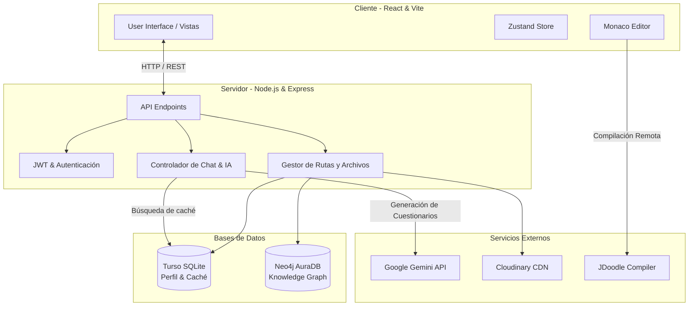

<div align="center">
  
  <h1>🧠 Plataforma de Rutas de Aprendizaje ESFOT</h1>
  <p><em>Plataforma educativa potenciada por Inteligencia Artificial, Grafos de Conocimiento y Entornos de Código en Vivo.</em></p>

  <p>
    
    
    
    
    
    
  </p>
</div>

## 📖 Descripción del Proyecto
La **Plataforma ESFOT** permite la generación de **Rutas de Aprendizaje Personalizadas** mediante Inteligencia Artificial. Los estudiantes pueden aprender conceptos teóricos adaptables, interactuar con un Chatbot Tutor (IA), realizar prácticas de código en tiempo real y ser evaluados de manera dinámica. Todo el progreso se almacena de forma relacional y se mapea en un **Grafo de Conocimiento** para futuras recomendaciones y visualización de logros.

---

## ✨ Características Principales
- 🤖 **Rutas Impulsadas por IA:** Generación de módulos de estudio a partir de documentos PDF o temarios usando *Google Gemini AI*.
- 📊 **Progreso en Grafos:** Integración con *Neo4j* para mapear la trayectoria del conocimiento `(Usuario)-[:COMPLETED]->(Módulo)`.
- 💻 **IDE Integrado:** Entorno interactivo con *Monaco Editor* para practicar código (JavaScript, Python, entre otros).
- ⚡ **Evaluaciones Dinámicas con Caché:** Cuestionarios y retos prácticos creados por IA al instante, cacheados inteligentemente en *Turso SQLite* para extremo rendimiento.
- ☁️ **Subida Segura en la Nube:** Integración optimizada con *Cloudinary* para la manipulación de PDFs e imágenes.

---

## 🏗️ Arquitectura del Sistema



---

## 🛠️ Tecnologías Usadas

### Frontend
- **Framework:** React 19 + Vite
- **Estilos:** Tailwind CSS v4
- **Manejo de Estado:** Zustand
- **Formularios:** React Hook Form + Zod
- **Extras:** React Router DOM, React Markdown, React Toastify

### Backend
- **Entorno:** Node.js + Express
- **Bases de Datos:** Turso (SQLite Remoto), Neo4j (Base de Datos Orientada a Grafos)
- **Seguridad:** JWT (JSON Web Tokens), Bcrypt, Multer Limits
- **Manejo de Archivos:** Cloudinary SDK

---

## 🚀 Instalación y Despliegue Local

### 1. Clonar el repositorio
```bash
git clone https://github.com/tu-usuario/tu-repositorio.git
cd tu-repositorio
```

### 2. Configurar el Backend
```bash
cd Backend-para-Despliegue-main/Backend-para-Despliegue-main
npm install
```
Asegúrate de configurar el archivo `.env` en base a lo documentado en `DOCUMENTACION_OFICIAL.md`. Luego, inicia el servidor:
```bash
npm run dev
```

### 3. Configurar el Frontend
Abre una nueva terminal en la raíz de tu proyecto:
```bash
cd Frontend
npm install
```
Verifica que tu archivo `.env` local contenga `VITE_API_URL=http://localhost:3000/api` y arranca Vite:
```bash
npm run dev
```

---

## 📝 Documentación Completa
Para ver el detalle profundo de la arquitectura, variables de entorno completas, seguridad, listado de tareas pendientes y endpoints, revisa el archivo [`DOCUMENTACION_OFICIAL.md`](./DOCUMENTACION_OFICIAL.md) incluido en la raíz de este proyecto.

<div align="center">
  <i>Desarrollado para ESFOT</i>
</div>
