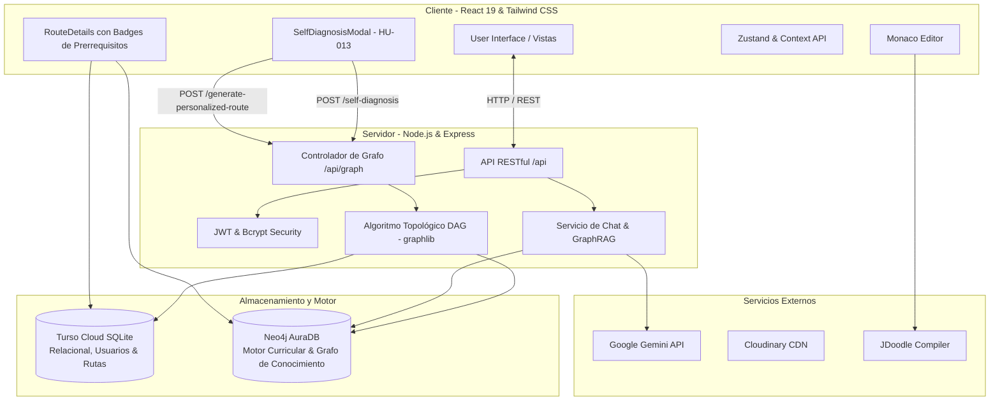

<div align="center">
  
  <h1>🧠 Plataforma de Rutas de Aprendizaje ESFOT</h1>
  <p><em>Plataforma educativa potenciada por Inteligencia Artificial, Grafos de Conocimiento (Neo4j AuraDB) y Rutas de Aprendizaje Adaptativas.</em></p>

  <p>
    
    
    
    
    
    
  </p>
</div>

## 📖 Descripción del Proyecto
La **Plataforma ESFOT** transforma la educación técnica universitaria convirtiendo su base de datos orientada a grafos (**Neo4j AuraDB**) en el **Motor Central de Conocimiento Curricular**. Los estudiantes pueden:
1. **Autodiagnosticarse por Temas (HU-013):** Evaluar sus conocimientos previos del 1 al 5 en materias troncales (*Redes de Computadoras* y *Aplicaciones Web*).
2. **Generar Rutas Adaptativas (HU-014):** Obtener una secuencia óptima de estudio computada mediante un algoritmo matemático de **orden topológico ponderado** (`graphlib`), el cual respeta dependencias estrictas (`HARD`), desarma ciclos y programa módulos de refuerzo para temas con dificultades (`STRUGGLES_WITH`).
3. **Tutoría IA con GraphRAG (HU-015):** Interactuar con un Chatbot potenciado por *Google Gemini* (`gemini-3.5-flash`) que recibe el subgrafo local del estudiante (prerrequisitos dominados, conceptos que desbloquea y recursos pedagógicos).
4. **Prácticas en Vivo y Evaluaciones:** Entorno interactivo con *Monaco Editor*, evaluaciones dinámicas con caché y gamificación reactiva en tiempo real (XP y Nivel).

---

## ✨ Características Principales
- 🧭 **Autodiagnóstico Curricular (HU-013):** Interfaz interactiva para mapear el estado cognitivo del estudiante en materias clave de la ESFOT.
- 📐 **Algoritmo Topológico DAG (`graphlib`) (HU-014):** Secuenciación pedagógica óptima, prevención de ciclos y persistencia dual segura (Turso SQLite + Neo4j con rollback compensatorio).
- 🤖 **GraphRAG en Tutoría IA (HU-015):** Inyección de subgrafos curriculares locales en los prompts del Chatbot para evitar alucinaciones y detectar vacíos conceptuales en vivo.
- ⚡ **Gamificación y Reactividad:** Actualización instantánea de XP y nivel en la barra superior al aprobar evaluaciones en `AIAssessmentForm`.
- 🛡️ **Seguridad Blindada:** Cero credenciales hardcodeadas, supresión de OTPs en logs, limitadores de tasa dedicados (`aiLimiter`) y cabeceras de seguridad con Helmet.

---

## 🏗️ Arquitectura del Sistema



---

## 🛠️ Tecnologías Usadas

### Frontend
- **Framework:** React 19 + Vite
- **Estilos:** Tailwind CSS v4
- **Manejo de Estado:** Context API + React Hooks
- **Formularios & Alertas:** React Toastify
- **Markdown:** React Markdown con sanitización de enlaces seguros

### Backend
- **Entorno:** Node.js (ES Modules) + Express.js
- **Motor de Grafos:** Neo4j Driver v6 + AuraDB (Instancia en la Nube)
- **Algoritmos:** `graphlib` (Kahn's Algorithm, Cycle Detection & Topological Sort)
- **Base de Datos Relacional:** Turso SQLite (`@libsql/client`)
- **Inteligencia Artificial:** Google Generative AI SDK (`gemini-3.5-flash`)
- **Seguridad:** Helmet, express-rate-limit, JWT, Bcrypt
- **Auditoría de Pentesting:** Strix (`usestrix/strix v1.7.0`)
- **Testing:** Jest con TDD para grafos dirigidos acíclicos

---

## 🚀 Instalación y Despliegue Local

### 1. Clonar el repositorio
```bash
git clone https://github.com/tu-usuario/tu-repositorio.git
cd tu-repositorio
```

### 2. Configurar el Backend
```bash
cd Backend-para-Despliegue-main/Backend-para-Despliegue-main
npm install
```
Asegúrate de configurar las variables de entorno en el archivo `.env` basándote en la plantilla `.env.example`.

#### Sembrado del Grafo de Conocimiento Curricular:
Puebla Neo4j AuraDB con las materias troncales (*Redes* y *Aplicaciones Web*), módulos, temas, recursos y restricciones únicas:
```bash
npm run seed:graph
```

#### Ejecutar Suite de Pruebas Unitarias (TDD):
Valida que el algoritmo topológico respete dependencias HARD, desarme ciclos y gestione grafos desconectados:
```bash
npm test
```

#### Iniciar Servidor:
```bash
npm run dev
```

### 3. Configurar el Frontend
Abre una nueva terminal en la raíz del proyecto:
```bash
cd Frontend
npm install
npm run dev
```

---

## 📝 Documentación Completa
Revisa el documento oficial [`DOCUMENTACION_OFICIAL.md`](./DOCUMENTACION_OFICIAL.md) para acceder a la especificación detallada de endpoints `/api/graph`, arquitectura de datos y manuales técnicos.

<div align="center">
  <i>Desarrollado para la Escuela Politécnica Nacional (EPN - ESFOT)</i>
</div>
